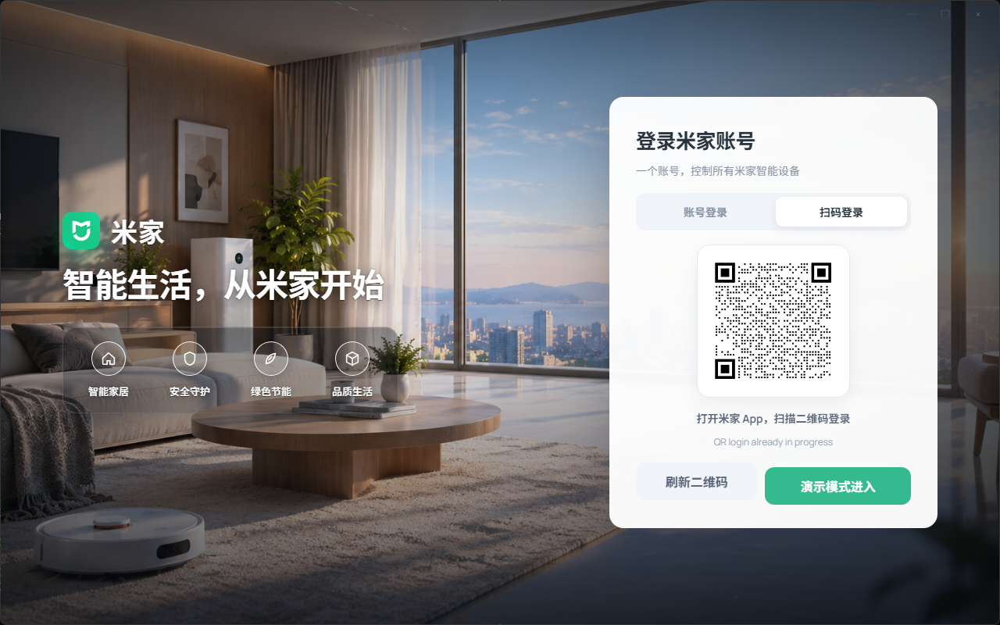
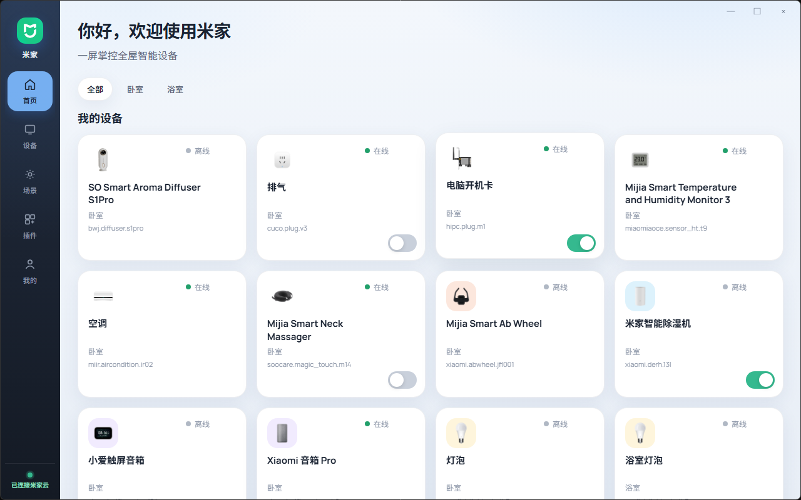
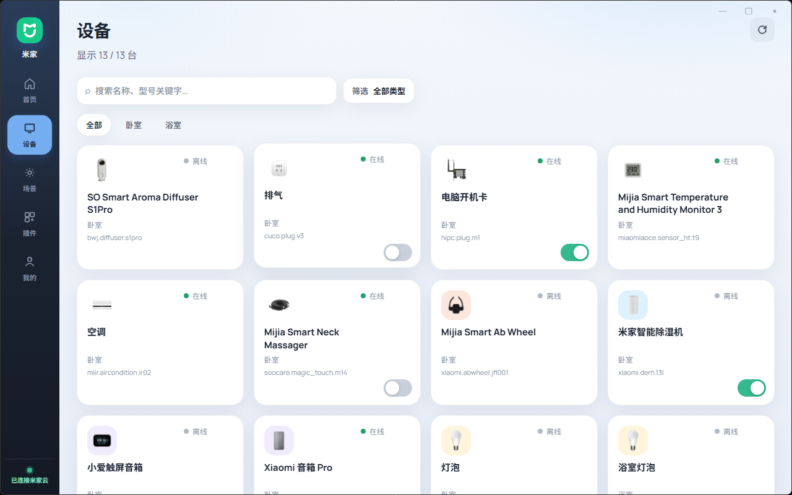
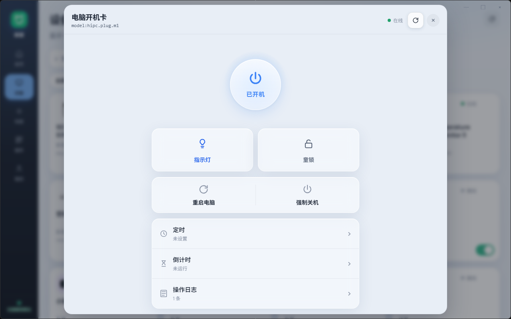
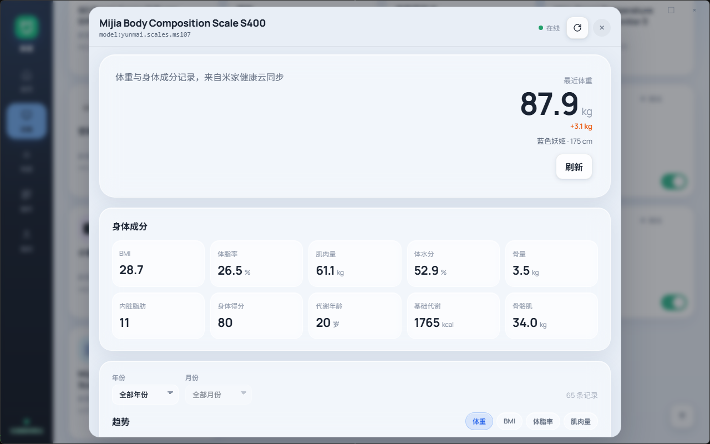
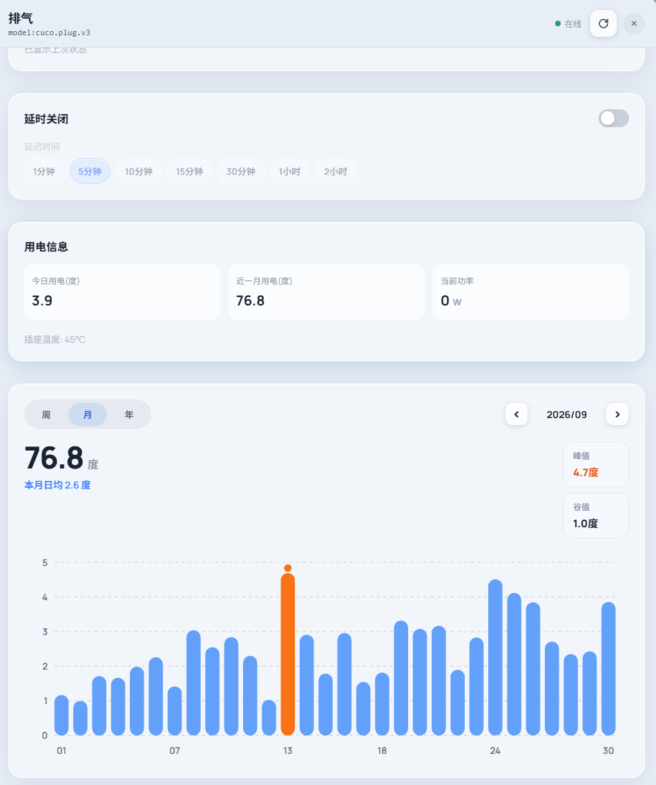
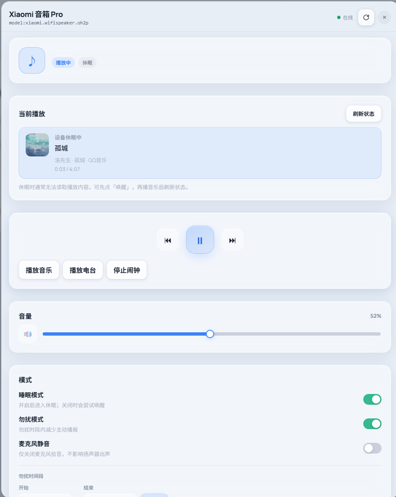
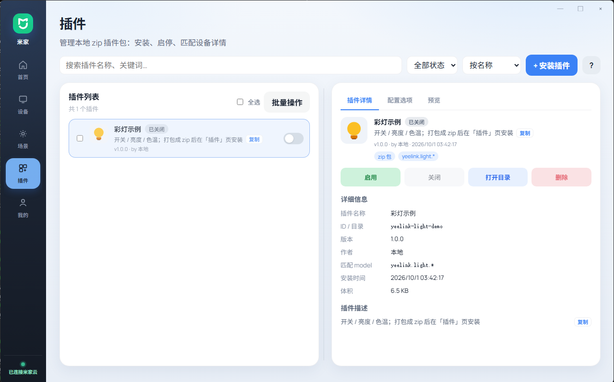
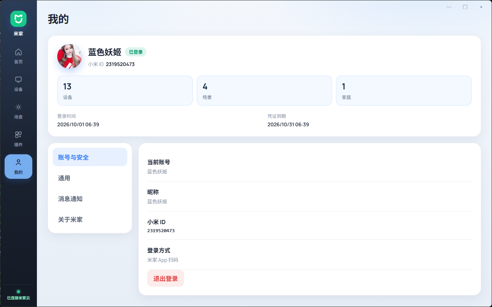

# 米家 PC

Windows 桌面端米家控制中心（第三方客户端）。扫码登录后管理家庭设备与场景，本机 Python Bridge 对接 [mijia-api](https://github.com/Do1e/mijia-api)。

> **非官方项目**，与小米 / 米家官方无关。使用自担风险。  
> 依赖库 **mijia-api** 为 **GPL-3.0**，本仓库若一并分发需遵守兼容开源协议。

## 成品展示



















## 现状说明

当前品类详情与特殊接口，主要按作者手头设备打通与打磨。列表、开关、通用 Spec 控件等能力可覆盖多数机型；**未特化的品类 / 机型**体验可能简陋或不完整。

欢迎米家爱好者按自家设备做适配：

| 方式 | 适合 | 说明 |
| --- | --- | --- |
| **React 插件（推荐）** | 单机型或系列 | zip 包安装，按 `model` 匹配覆盖详情 UI，无需改主仓也可自用 |
| **品类预制页** | 整类设备 | 向本仓库贡献 `apps/desktop/src/devices/` 下的 React 详情页 |
| **Bridge 接口** | 云端专有 API | 在 `apps/bridge` 补充历史、日志等后端能力 |

示例插件：[`docs/plugins/yeelink-light-demo/`](./docs/plugins/yeelink-light-demo/)  
品类约定：[`docs/设备详情页文档.md`](./docs/设备详情页文档.md)  
应用内「插件 → 编写说明」可复制 API 与示例代码。

## 功能概览

- 扫码登录、家庭 / 房间 / 设备列表、场景执行
- 设备详情弹窗：品类预制 UI + 完整 Spec「全部能力」
- 本地 React 插件（zip：`config.json` + `index.jsx|tsx` + 资源）
- 中 / 英界面、浅色 / 暗黑 / 跟随系统
- 演示模式（无需账号预览 UI）
- 本机 Bridge API 文档：Swagger `/docs`、ReDoc `/redoc`（设置 → 关于米家可打开）

### 已特化品类（随作者设备演进）

净化器、灯、插座、音箱、体脂秤、健腹轮、红外空调、按摩仪、除湿机、电脑开机卡等；摄像 / 门锁等多为骨架 + Spec 兜底。未列出的品类（如扫地机等）优先用通用 Spec，或通过插件 / PR 扩展。

## 技术栈

| 模块 | 技术 |
| --- | --- |
| 桌面 | Electron + React 19 + TypeScript + Vite |
| 状态 / 路由 / i18n | Zustand、React Router、i18next |
| Bridge | FastAPI + uvicorn + [mijia-api](https://github.com/Do1e/mijia-api) |
| 包管理 | pnpm workspace + [uv](https://github.com/astral-sh/uv) |

架构与约定见 [`开发方案.md`](./开发方案.md)，进度见 [`项目进度.md`](./项目进度.md)。

## 环境要求

- Windows（当前主要目标平台）
- Node.js ≥ 20、pnpm ≥ 9
- [uv](https://docs.astral.sh/uv/)（Bridge 依赖与运行）

## 本地开发

```bash
pnpm install

# 终端 1 — Bridge（127.0.0.1:8787）
pnpm bridge:dev

# 终端 2 — 桌面端
pnpm dev
```

正式使用时，桌面端主进程也会拉起并守护 Bridge；开发阶段建议单独跑 `bridge:dev` 便于看日志。

| 地址 | 说明 |
| --- | --- |
| http://127.0.0.1:8787/health | 健康检查 |
| http://127.0.0.1:8787/docs | Swagger API 文档 |
| http://127.0.0.1:8787/redoc | ReDoc |

### 登录方式

- **正式**：登录页扫码（需 Bridge 在线）
- **演示**：点「演示模式进入」，走 Mock 数据，不连账号

语言可在登录页 / 设置中切换（偏好写入 `localStorage`：`mi-home-locale`）。

## 打包

```bash
pnpm dist
```

会先冻结 Bridge，再打 Windows NSIS 安装包，产物大致在 `apps/desktop/release/`。自动更新与代码签名尚未完善。

## 插件适配（爱好者）

1. 参考 `docs/plugins/yeelink-light-demo/`，准备 `config.json`（`match` 支持 `yeelink.light.*` 等通配）与 `index.jsx` / `index.tsx`
2. 打成 zip，在应用「插件」页安装
3. 打开对应设备详情，匹配成功后即用插件 UI（优先级高于品类预制页）

详情渲染顺序：**电脑开机卡 → 匹配插件 → 品类预制 → Generic Spec**。

## 目录结构（简）

```text
apps/desktop/          Electron + React 客户端
apps/bridge/           FastAPI 本机 Bridge
docs/screenshots/      README 成品截图
docs/plugins/          插件示例包
开发方案.md            架构与能力映射
项目进度.md            完成度与待办
```

## 免责声明

本项目仅供学习与个人使用。请遵守小米 / 米家用户协议与当地法规；勿用于未授权访问或商业侵权用途。云端接口、机型 Spec 可能变更，适配结果不保证长期稳定。
